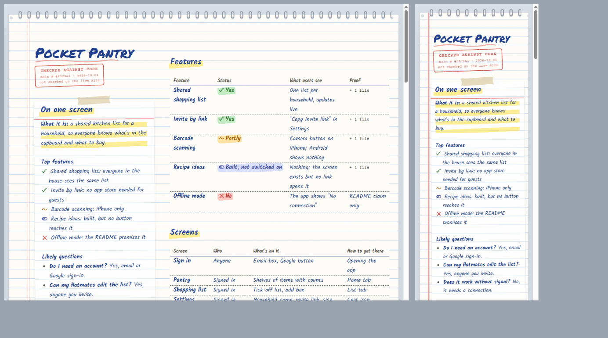
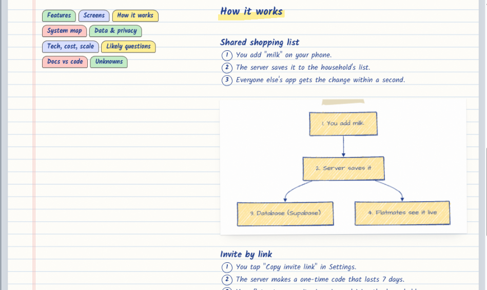

# draw-it-out

draw-it-out is a Claude Code plugin for people who build apps with AI, then get asked "does your app do X?" or "how does that work?" and don't know the answer.

It reads your code and tells you what the app really does. Every answer starts with a status label and comes with the file that proves it. The plugin also keeps a one-screen cheat sheet you can read on your phone before a call, draws the app as a hand-drawn notebook page, and helps you learn the app with quizzes, guided tours and meeting prep.



## Get started

1. Install the plugin, then start a new Claude Code session:

   ```text
   /plugin marketplace add chandler-bong/draw-it-out
   /plugin install draw-it-out@draw-it-out
   ```

2. Open one of your projects and type `/draw-it-out`. The first time, it asks whether to scan the project. Choose "Scan now". A scan takes about 15 minutes for a small app and up to an hour for a big one, and it only runs once per project.
3. Ask a question:

   ```text
   /draw-it-out quick does it work offline?
   ```

That's the whole setup. After the scan, every command checks git for changes and updates only the parts of the notes that changed.

## What an answer looks like

These examples come from a made-up shopping-list app. A quick answer is one sentence:

```text
/draw-it-out quick can I scan barcodes?

🟡 Partly: on iPhone you can scan a barcode to add an item, but the Android app has no scanner.
```

A full answer adds how it works, the proof and one thing to remember:

```text
/draw-it-out can I scan barcodes?

🟡 Partly: on iPhone you can scan a barcode to add an item, but the Android app has no scanner.

How it works:
1. You tap the camera button on the Pantry screen.
2. The phone reads the barcode and looks the product up in a free food database.
3. The item lands in your household's pantry.

Proof: app/scan/Scanner.tsx:12
Checked on main@4f2c9a1.
Remember this: barcode scanning is iPhone only.
```

## Commands

Everything runs through one command. The words after it pick the job.

### Answers

| You type | You get |
|---|---|
| `/draw-it-out quick <question>` | One sentence: the status label and the answer |
| `/draw-it-out <question>` | The full answer: label, how it works in 3 steps, proof and a line to remember |
| `more` or `deeper` (reply after an answer) | The full answer after a quick one, or the technical version: files, functions and services |

### Notes and the page

| You type | You get |
|---|---|
| `/draw-it-out` | Your one-screen cheat sheet and the page link. In a project with no notes yet, it offers to scan |
| `/draw-it-out scan` | A full scan the first time, then an update of whatever changed. `refresh` and `update` do the same |
| `/draw-it-out page` | A rebuilt notebook page and its link |

### Learning

| You type | You get |
|---|---|
| `/draw-it-out quiz` | 5 multiple-choice questions about your own app, scored at the end |
| `/draw-it-out tour` | One feature at a time. Reply `next`, `deeper` or `stop` |
| `/draw-it-out prep investor call` | A pitch, the 5 questions they'll probably ask, one tough question and what not to oversell |

Add "for an investor", "for a developer" or "for my mum" to any question and the answer is written for that person. If another plugin already uses the name, type `/draw-it-out:draw-it-out` instead.

## Status labels

Every feature gets one of four labels, checked against the code:

- ✅ **Yes**: a user can reach it and it does the real work.
- 🟡 **Partly**: a user can reach it, but it's limited. It might have unfinished parts or mock data, be missing on one platform, or sit behind a switch you can't see.
- 🔌 **Built, not switched on**: the code exists, but nothing lets a user reach it.
- ❌ **No**: it isn't in the code. If your README claims it, you'll be told.

The labels describe the code you have checked out, not your live site. When your own docs say a feature isn't released yet, the answer says so.

## The notebook page

The scan turns your notes into a private page that looks like a spiral notepad. The summary sits on a taped index card, statuses are ticked and highlighted, warnings go on sticky notes, and the system map, screen map, feature flows and data map are sketched in pencil.



On a phone the page is one column. On a wide screen the summary sits on the left, the notes run down the right, and the section tabs stay in view as you scroll. Links like `#data-privacy` jump straight to a section.

If your Claude Code has artifacts, the page goes up as a private claude.ai link that only you can see until you share it. If it doesn't, open the local HTML file in a browser.

## Where things live

- Notes: `~/.draw-it-out/<app>.md`. There's one file per app, kept outside your repos so half-finished features never end up in a public one.
- Page: `~/.draw-it-out/<app>.html`.

It never writes anything inside your project.

## Writing style

Everything the plugin writes goes through [humanizer](https://github.com/blader/humanizer) if you have it installed. If you don't, it follows a short version of the same rules that ships with the plugin.

## Limits

- It checks the code, not the deployed site. A ✅ means "built and reachable in this code". It doesn't mean "live in production".
- It won't guess costs, user numbers or security guarantees. If the code doesn't prove something, it says "not verified".
- Scans are slow and use a lot of tokens on big repos. A 900-file app with web, iPhone and Android versions took 45 minutes. A question takes a few minutes.

## License

MIT
