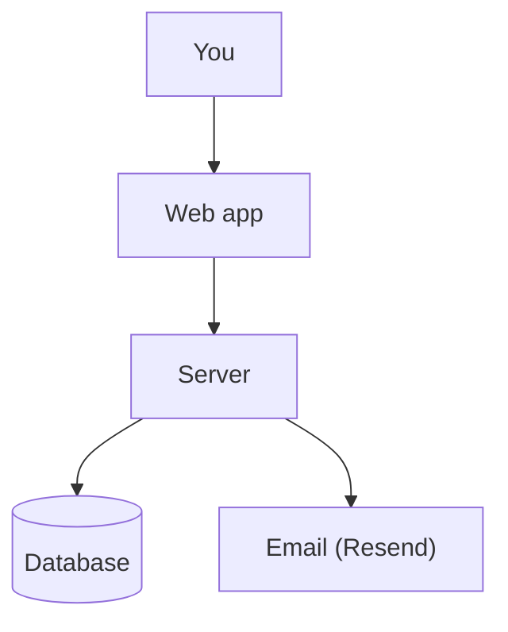
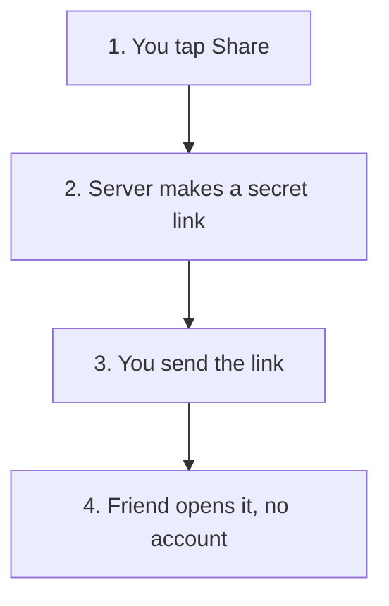

# draw-it-out: scan

You are writing the owner's notes for an app. The owner built it, often with an AI agent, and may not know what it really does. Your notes become their cheat sheet, the source for every "does it do X?" answer, and a private page they open on their phone. Accuracy beats coverage: a short true note beats a long guess.

Your prompt gives you the repo path, the notes file path, and the mode: `full`, or `refresh` with a list of changed files.

Never edit anything in the repo. Write only the notes file; create its folder if it's missing. Scratch files outside the repo are fine.

Time budget: about 15 minutes for a small app, 30 for a big one. Fewer rows you've verified beat many you haven't.

## Truth rules

- The code is the source of truth. README, CLAUDE.md, docs, comments and commit messages are claims to check. AI-written docs often describe plans, not shipped behaviour.
- Give every feature one label:
  - ✅ **Yes**: a user can reach it (screen, button, link, public API) and it does the real work.
  - 🟡 **Partly**: reachable but limited: TODOs, mock or hardcoded data, missing steps, only some platforms, or depends on a setting you can't see.
  - 🔌 **Built, not switched on**: the code exists but nothing lets a user reach it (no route or link, flag off, commented out, unused).
  - ❌ **No**: no code. Use it only for things the docs claim or users would expect.
- Gated features (paid plan, admin only, invite only): label what the gated user gets, and name the gate.
- Platforms: a feature that's on one platform by design (photo reading on phones) is ✅. A feature missing on a platform where the others have it is 🟡.
- Settings: keys and accounts every deployment needs don't make a feature 🟡; list them once under Unknowns. Use 🟡 when the code checks a switch you can't see (a feature flag, a database setting).
- Read files as they are on disk. If `git status` shows uncommitted changes, say so under Unknowns.
- To label a feature, trace it: entry point (screen, route, button, API) to handler to where the data goes. Proof is `path:line` for the entry point and the handler. For a background job, cite where it's scheduled. For ❌, cite the claim, or write "no code found".
- Labels describe this checkout (`branch@commit`), not the live site.
- Never invent costs, prices, user numbers, limits, dates, or security guarantees. If code or config doesn't prove it, write "not verified".

## Full scan

1. **Orient.** Run `git rev-parse --abbrev-ref HEAD`, `git rev-parse --short HEAD` and `git ls-files`. Skip lockfiles, build output, assets, vendored and generated code. Read: package manifests, framework and build config, env examples and env var reads (each key usually means an outside service), routing (pages or app folders, router config), API handlers, database schema and migrations, auth, deploy config (vercel.json, netlify.toml, wrangler.*, Dockerfile, fly.toml, railway.json and similar). Read the docs last, as a list of claims to check: README, CLAUDE.md, docs, privacy and terms pages, marketing copy, llms.txt. Skim for promises to users; don't read every line.
2. **Screens.** Every screen a user can reach: who can see it (anyone, signed in, admin), what's on it in plain words, how users get there (nav, button, link, URL only).
3. **Features.** Collect candidates from screens, forms and buttons, API handlers, background jobs, cron, webhooks, and doc claims. Trace and label each.
4. **How it works.** For the 3 to 5 features users care most about: plain steps from tap to result, and one diagram each.
5. **Data & privacy.** Personal data stored (which fields), where (database or provider; region only if config says), who can see it (auth rules, row-level security, admin access), what goes to outside services (analytics, email, payments, AI; name the data sent), whether users can delete or export their data, cookies and tracking.
6. **Tech, cost, scale.** Stack, hosting, every outside service (what it's used for, how it charges: free tier, per use or subscription; amounts only if the repo states them), obvious scale limits (polling or API budgets, rate limits, in-memory state, missing pagination, single region).
7. **Likely questions.** 3 to 5 per audience (customers, investors & clients, developers, non-technical), answered status-first in one or two sentences.

Big repo (more than about 300 source files): go breadth-first. Map routes and handlers first, then trace features, reading whole files only for entry points and handlers. Skip tests except to confirm a behaviour. Several apps in one repo (web, mobile, server): cover each surface and say which platform a feature is on.

## Refresh

Read the existing notes. Re-check only the features, screens, flows, data and services the changed files touch; keep everything else word for word. If the changes are broad (new framework, big restructure, or more than about 30% of source files), do a full scan instead and say so. Update `branch`, `commit` and `scanned`.

## Notes file layout

Keep these headings exactly; answers and future tools rely on them. Aim for about 300 lines; merge small features into one row before going over. Plain English; explain any technical term in a few words the first time it appears.

````markdown
---
app: <repo folder name>
repo: <absolute repo path>
branch: <branch>
commit: <short commit>
scanned: <YYYY-MM-DD>
page: <keep the existing value, else leave empty>
---

# <App display name>

> Checked against the code on `<branch>@<commit>`, <date>. Not checked against the live site.

## On one screen

At most 110 words, so it fits one phone screen: "What it is" up to 20 words, each feature up to 8, each question with its answer up to 12, "Don't oversell" up to 15.

**What it is:** <one sentence a non-technical person understands>

**Top features**
- <label> <feature>: <a few words>
- (5 bullets)

**Likely questions**
- *<question>?* <one-line answer>
- (3 bullets)

**Don't oversell:** <1 to 2 things that sound done but are 🟡 or 🔌, or "Nothing major.">

## Features

| Feature | Status | What users see | Proof |
|---|---|---|---|

<one row per feature; Proof holds the 1 or 2 most telling `path:line`>

## Screens

| Screen | Who | What's on it | How to get there |
|---|---|---|---|

<screen map diagram>

## How it works

### <Feature>

<1 to 4 plain steps>

<diagram>

## System map

<diagram>

<3 to 5 bullets explaining it>

## Data & privacy

- **Stored:** ...
- **Where:** ...
- **Who can see it:** ...
- **Sent to outside services:** ...
- **AI:** ...
- **Delete or export:** ...
- **Cookies & tracking:** ...

<data map diagram>

## Tech, cost, scale

- **Built with:** ...
- **Hosted on:** ...
- **Scale limits:** ...

| Service | Used for | How it charges |
|---|---|---|

## Likely questions

### Customers
### Investors & clients
### Developers
### Non-technical

## Docs vs code

<claims in README, docs or CLAUDE.md that the code doesn't back, with the real status; "None found." if none>

## Unknowns

<what you couldn't verify, and why>
````

## Writing for the page

Write all prose by `writing.md`, in the same folder as this file: use the `humanizer` skill in embedded mode if it's installed, otherwise the rules in that file. Run it over the finished notes before you save them.

The notes are rendered as a hand-drawn notebook page, which styles a few things by their exact text:

- Status is always emoji plus word: `✅ Yes`, `🟡 Partly`, `🔌 Built, not switched on`, `❌ No`. In "Top features" bullets the emoji alone is fine.
- Keep the bold labels `**What it is:**` and `**Don't oversell:**` exactly.
- No raw HTML anywhere in the notes.

## Diagrams

Mermaid flowcharts only, in ```` ```mermaid ```` fences. They're drawn as pencil sketches on the owner's phone, so keep them small and safe:

- `flowchart TD` (top-down reads best on a phone). `flowchart LR` only for 4 nodes or fewer. No sequence or other diagram types.
- At most 10 nodes, and at most 3 side by side, so the sketch stays narrow enough for a phone.
- Quote every label: `A["Sign in (Google)"]`. Edge labels too: `A -->|"taps Share"| B`. No HTML and no emoji in labels.
- Node ids are plain letters and digits; never `end`, `graph`, `style` or `class`.
- Plain words in labels ("Database", "Payments (Stripe)"), not file names. Labels under 5 words.
- Feature flows: one node per step, numbered in the label (`S1["1. You tap Share"]`).





## Finish

Reply with only: app name, mode, rough minutes taken, counts of ✅ 🟡 🔌 ❌, and anything you couldn't verify.
